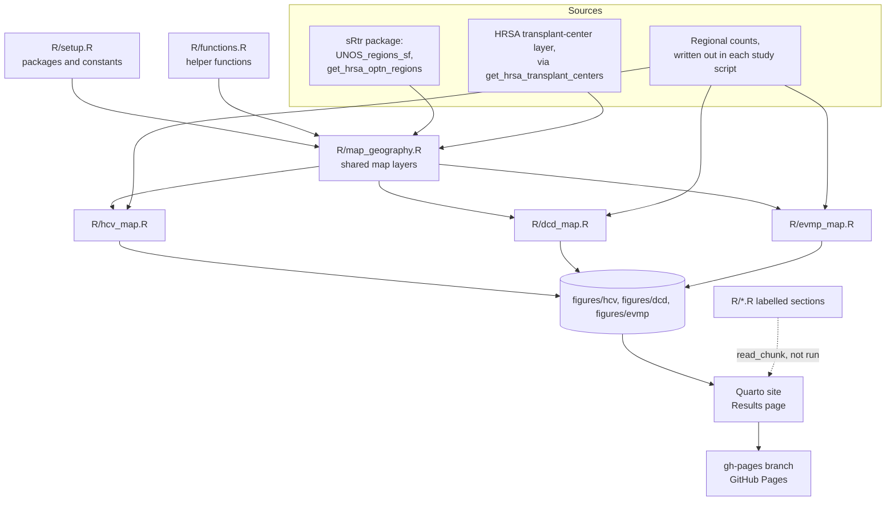

# Architecture

How the code that draws the regional maps is organized, as implemented on the `site-ready` branch (November 2026). The [analysis plan](https://github.com/VagishHemmige/UNOS-mapping/blob/main/analysis-plan.md) says what the maps must show; [AGENTS.md](https://github.com/VagishHemmige/UNOS-mapping/blob/main/AGENTS.md) says how to work on them.

## Overview

`R/main.R` runs six scripts in order. The first two set up packages, constants and helper functions. `R/map_geography.R` builds the map layers every study shares, from the sRtr package and the live HRSA transplant-center layer. Each study script then holds that study's regional counts, joins them to the shared layers, and saves two maps per measure to `figures/<study>/`: one drawn with ggplot2 and one with tmap, with an inset of the Washington-Boston corridor.

The Quarto website explains the scripts. Its pages import the scripts' labelled sections with `knitr::read_chunk()` and show them; they never run the analysis. The Results page shows the saved maps. A GitHub Actions workflow runs `R/main.R`, renders the site and publishes it on every push to `main`, so the maps and the site are always drawn from the code on `main`.

## Architecture diagram

## Components

### Setup

**Purpose**: attaches every package and defines every constant the other scripts use.

**Location**: `R/setup.R`

**Key symbols**: `map_crs`, `corridor_extent`, `fill_palette`, `missing_fill`, `center_organ`, `adult_center_exceptions`, `figure_width`, `figure_height`.

**Interactions**: sourced first by `R/main.R`; no inputs; produces attached packages and constants.

### Helper functions

**Purpose**: reusable steps shared by every study. Each takes its inputs as arguments and reads no global objects.

**Location**: `R/functions.R`

**Key functions**:
- `join_region_values()`: attaches a study's regional table to the state polygons by region name; stops if any of the eleven regions is missing.
- `select_adult_centers()`: keeps centers listing the organ, one row per `OTC_CD`, applies the pediatric name rule, projects to `map_crs`, and drops centers outside the mapped states.
- `map_regions_ggplot()`: the ggplot2 map (states shaded by region value, region outlines, region numbers, centers).
- `map_regions_tmap()`: the same map in tmap 4, with the corridor inset and the legend outside the map frame.
- `save_region_maps()`: saves both versions as PNG under `figures/<study>/`.

**Interactions**: sourced second; used by `R/map_geography.R` and the study scripts.

### Map geography

**Purpose**: builds the layers every study shares, all in `map_crs`.

**Location**: `R/map_geography.R`

**Produces**:
- `region_states`: state polygons tagged with UNOS region (from `UNOS_regions_sf`).
- `region_outlines`: one polygon per region (from `get_hrsa_optn_regions()`).
- `region_labels`: one point inside each region, for its number (`st_point_on_surface()`).
- `heart_centers`: adult heart-transplant centers from the live HRSA layer.
- `corridor_bbox`: the inset extent, `corridor_extent` projected to `map_crs`.

**Interactions**: needs setup and functions; downloads the HRSA layer each run; feeds every study script.

### Study scripts

**Purpose**: one per published study. Each writes out its regional counts with `tibble::tribble()`, computes its percentages, joins them to `region_states`, and draws and saves one pair of maps per measure.

**Location**: `R/hcv_map.R`, `R/dcd_map.R`, `R/evmp_map.R`

**Produces**: `hcv_summary`, `hcv_states`; `dcd_summary`, `dcd_states`; `evmp_summary`, `evmp_states`; and the PNG files in `figures/hcv/`, `figures/dcd/` and `figures/evmp/`. Each map is saved twice: `<measure>.png` (ggplot2) and `<measure>_inset.png` (tmap).

**Interactions**: need the shared layers; independent of each other.

### Website

**Purpose**: explains the code and shows the maps.

**Location**: `_quarto.yml`, `index.qmd`, `404.qmd`, `quarto/`, rendered to `docs/` (not committed).

**Interactions**: code pages import labelled sections of `R/*.R` with `knitr::read_chunk()` and show them without running them. The Results page (`quarto/results.qmd`) shows the PNG files in `figures/`. The project-document pages include `analysis-plan.md`, `AGENTS.md` and `REPOSITORY-BLUEPRINT.md`, and this file is read by `quarto/architecture.qmd`.

### Publish workflow

**Purpose**: draws the maps with `R/main.R`, renders the site and publishes it to the `gh-pages` branch, which GitHub Pages serves.

**Location**: `.github/workflows/publish.yml`

**Interactions**: runs on every push to `main` and by hand (Actions → Draw maps and publish website → Run workflow). On a pull request it draws and renders without publishing, as a check. It installs sRtr from GitHub and the other packages from CRAN, and needs internet access to the HRSA server. A failed run publishes nothing, so the last good site stays live.

### Provenance

`original/` holds the RMDs that drew the published maps, with local paths removed. `data/hrsa/Transplant centers.csv` is the HRSA file those maps used; the code does not read it, but it is kept for provenance and for checking the pediatric-center rule (decision D2 in `SETUP-NOTES.md`).

## Data flow

1. `R/setup.R` attaches packages and sets constants; `R/functions.R` defines the helpers.
2. `R/map_geography.R` takes the state polygons and region outlines from sRtr, downloads the HRSA center layer, narrows it to adult heart centers, and projects every layer to EPSG:5070.
3. Each study script builds its regional table from counts written in the script, computes percentages (shares of the national count for HCV and DCD; the region's own rate for EVMP), and joins the table to the state polygons.
4. For each measure, the study script draws the ggplot2 and tmap maps and saves them to `figures/<study>/`.
5. Quarto renders the site, copying the maps for the Results page, and the publish workflow pushes it to the `gh-pages` branch.

## Configuration

All settings are constants in `R/setup.R`; no environment variables or data paths are needed. The region geography comes with sRtr, and the regional counts are in the study scripts. The HRSA layer is downloaded from `gisportal.hrsa.gov`, so a run needs internet access to that host.

## Code references

| Component | File | Key symbols |
|---|---|---|
| Orchestration | `R/main.R` | sources the scripts in order |
| Setup | `R/setup.R` | `map_crs`, `corridor_extent`, `adult_center_exceptions` |
| Helpers | `R/functions.R` | `join_region_values()`, `select_adult_centers()`, `map_regions_ggplot()`, `map_regions_tmap()`, `save_region_maps()` |
| Shared layers | `R/map_geography.R` | `region_states`, `region_outlines`, `region_labels`, `heart_centers`, `corridor_bbox` |
| HCV study | `R/hcv_map.R` | `hcv_summary`, `hcv_measures` |
| DCD study | `R/dcd_map.R` | `dcd_summary`, `dcd_measures` |
| EVMP study | `R/evmp_map.R` | `evmp_summary`, `evmp_measures` |
| Results page | `quarto/results.qmd` | reads `figures/` |
| Workflow | `.github/workflows/publish.yml` | runs `R/main.R`, renders, publishes to `gh-pages` |

## Glossary

| Term | Definition |
|---|---|
| UNOS region | One of the eleven groups of states the OPTN uses; sRtr assigns each state to one region |
| `map_crs` | EPSG:5070, NAD83 / Conus Albers, the projection of every layer |
| Corridor inset | The enlarged view of DC to Boston in the tmap maps |
| Share of the national count | A region's count divided by the U.S. total (HCV and DCD percentages) |
| Region's own rate | A region's count divided by its own transplants (EVMP percentage) |
| `OTC_CD` | HRSA's transplant-center code, used to keep one row per center |
