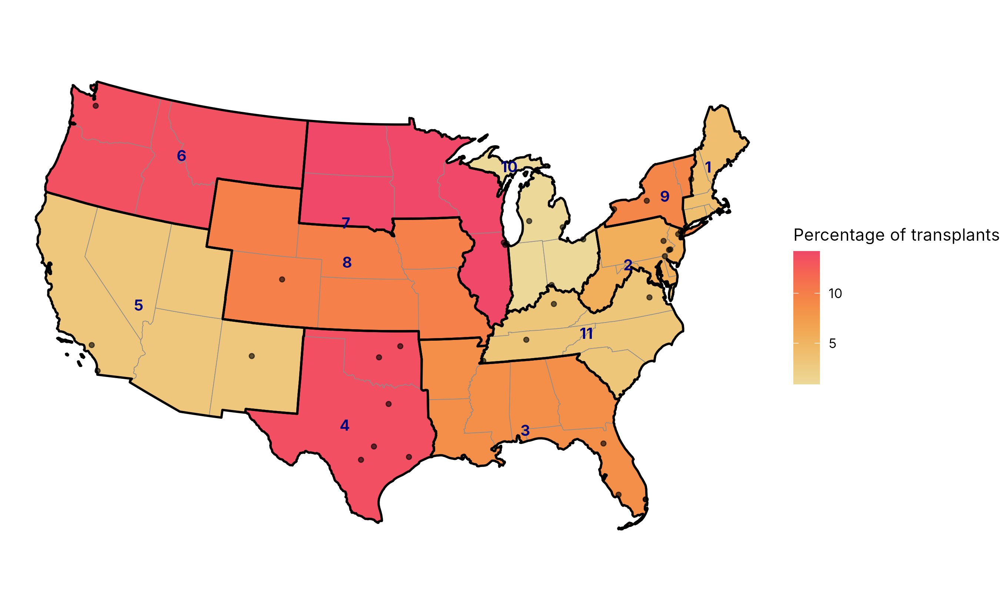

A short introduction to drawing maps in R, enough to follow the code on this site. For a fuller treatment, Kyle Walker's *Analyzing US Census Data* is free online [@walker2023census]. Its chapters on [Census geographic data](https://walker-data.com/census-r/census-geographic-data-and-applications-in-r.html), [mapping](https://walker-data.com/census-r/mapping-census-data-with-r.html) and [spatial analysis](https://walker-data.com/census-r/spatial-analysis-with-us-census-data.html) cover everything here in more depth, with US examples. The links below point to the relevant sections.

## Spatial data are data frames with a geometry column

The sf package stores spatial data as an ordinary data frame with one extra column, `geometry`, holding a point, line or polygon for each row. So the usual dplyr verbs work on it: `filter()` keeps some regions, `left_join()` attaches a table of values, and `group_by()` with `summarise()` merges polygons, which is how states become regions. Walker introduces sf objects in [§5.1.1](https://walker-data.com/census-r/census-geographic-data-and-applications-in-r.html#understanding-tigris-and-simple-features).

On this site, sRtr supplies the sf objects: `UNOS_regions_sf` (one polygon per state, tagged with its UNOS region), `get_hrsa_optn_regions()` (one polygon per region) and `get_hrsa_transplant_centers()` (one point per center and organ) [@srtr_package]. Walker uses the tigris package for Census boundaries in the same way; sRtr's state polygons come from the same Census cartographic boundary files.

## Coordinate reference systems

Every geometry is stored in a coordinate reference system (CRS). Longitude and latitude are angles, not distances; drawn as if they were x and y, they stretch the United States east to west and make northern states look larger than they are. A projected CRS such as NAD83 / Conus Albers (EPSG:5070) is designed for the contiguous states and keeps areas comparable, which matters when the eye reads shaded area.

Two habits follow. Transform every layer to the one CRS with `sf::st_transform()` before combining or plotting them, as the HOPE-CDC analysis does, rather than relying on the plotting function to reconcile them. And set the CRS of the plot itself with `coord_sf(crs = ...)`. Walker covers both, and how to choose a projection with the crsuggest package, in [§5.4](https://walker-data.com/census-r/census-geographic-data-and-applications-in-r.html#coordinate-reference-systems).

## A choropleth: shading areas by a value

A choropleth shades each area by a value. In ggplot2, `geom_sf(aes(fill = value))` draws it; a sequential colour scale suits a quantity that runs from low to high. Walker builds one step by step in [§6.2](https://walker-data.com/census-r/mapping-census-data-with-r.html#map-making-with-ggplot2-and-geom_sf), including the `theme_void()` and `labs()` calls used here.

When the value belongs to a UNOS region, every state in the region is shaded the same. Thin state lines under thick region outlines remind the reader of that: the shading says nothing about any state alone. Several UNOS regions also cross state lines (Northern Virginia is in Region 2, for example); sRtr assigns each state to one region, so the map is an approximation at those edges.

## Points on the map

Transplant centers are points. Drawn with `geom_sf()` at their true locations, partly transparent, they show where programs are and where they cluster. The original maps used `geom_jitter()`, which separates overlapping points by moving each one randomly, so no center is where it should be.

## tmap and insets

tmap is a second mapping package, built for thematic maps; Walker introduces it in [§6.3](https://walker-data.com/census-r/mapping-census-data-with-r.html#map-making-with-tmap). His examples use tmap 3. This site uses tmap 4, whose syntax changed: `tm_polygons(fill = ...)` with `fill.scale` and `fill.legend` replaces arguments such as `col`, `style` and `palette`. The [tmap website](https://r-tmap.github.io/tmap/) documents version 4.

An inset repeats part of the map at a larger scale beside it. Between Washington and Boston, transplant centers sit so close together that they overlap on a national map; tmap's `tm_inset()` draws that corridor enlarged. For a related problem, fitting Alaska, Hawaii and Puerto Rico onto a national map, Walker shows tigris's `shift_geometry()` in [§5.5.1](https://walker-data.com/census-r/census-geographic-data-and-applications-in-r.html#shifting-and-rescaling-geometry-for-national-us-mapping); the maps here leave those places out, as the published maps did.

## What the result looks like

{fig-alt="Map of the contiguous United States in an Albers projection. States are shaded orange to red by a synthetic value for their UNOS region, with thick black outlines around the eleven regions, each labelled with its number in navy, and small grey dots for synthetic transplant-center locations. The dots between Washington and Boston crowd together."}
