The regional maps for each study, drawn by `R/main.R` from the counts published in each paper. Each map opens with the version drawn with tmap, with the Washington-Boston corridor enlarged beside it; the second tab shows the same map drawn with ggplot2, without the inset. States are shaded by their UNOS region's value; dots are adult heart-transplant centers from the current HRSA layer, so they show centers as they are now, not as they were during each study period.

::: {.Results title="Where these maps come from"}
The maps are saved to `figures/` by the study scripts ([HCV](hcv_map.qmd), [DCD](dcd_map.qmd), [machine perfusion](evmp_map.qmd)) and are redrawn on GitHub, from the code on `main`, each time the site is published (see [Architecture](architecture.qmd)). This page only shows the saved files; it runs no code.
:::

## HCV donors, 2015–2020

From @madan2021hcv.

### Share of U.S. HCV-donor multiorgan heart transplants

::: {.panel-tabset}

#### With corridor inset (tmap)

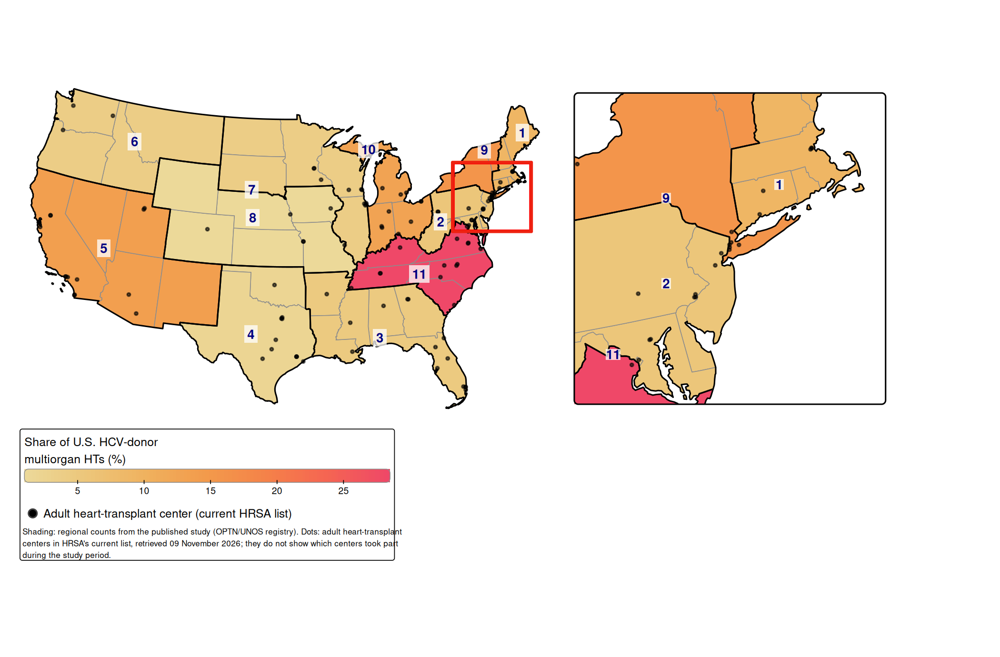{fig-alt="Map of the contiguous United States in an Albers projection, with states shaded by UNOS region from light yellow (low) to red (high) showing share of U.S. HCV-donor multiorgan heart transplants. Region 11 had the largest share (28%), followed by Regions 9 (16%), 5 (14%) and 10 (13%); Region 8 had the smallest (under 1%). Thin outlines mark the eleven regions, each labelled with its number, and dots mark adult heart-transplant centers. An enlarged view of the corridor from Washington, DC, to Boston sits to the right of the map."}

#### Without inset (ggplot2)

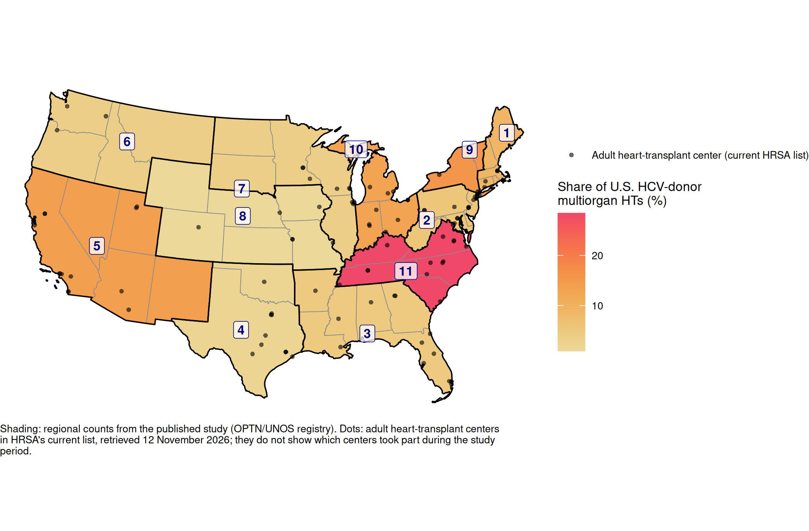{fig-alt="Map of the contiguous United States in an Albers projection, with states shaded by UNOS region from light yellow (low) to red (high) showing share of U.S. HCV-donor multiorgan heart transplants. Region 11 had the largest share (28%), followed by Regions 9 (16%), 5 (14%) and 10 (13%); Region 8 had the smallest (under 1%). Thin outlines mark the eleven regions, each labelled with its number, and dots mark adult heart-transplant centers."}

:::

## DCD donors, 2020–2023

From @madan2024dcd.

### Number of multiorgan heart transplants with DCD donors

::: {.panel-tabset}

#### With corridor inset (tmap)

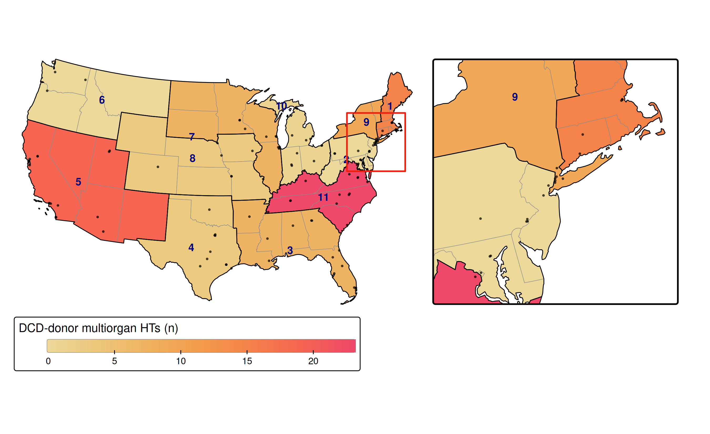{fig-alt="Map of the contiguous United States in an Albers projection, with states shaded by UNOS region from light yellow (low) to red (high) showing number of multiorgan heart transplants with DCD donors. Region 11 had the most (23), then Regions 5 (19) and 1 (15); Regions 2 and 6 had none. Thin outlines mark the eleven regions, each labelled with its number, and dots mark adult heart-transplant centers. An enlarged view of the corridor from Washington, DC, to Boston sits to the right of the map."}

#### Without inset (ggplot2)

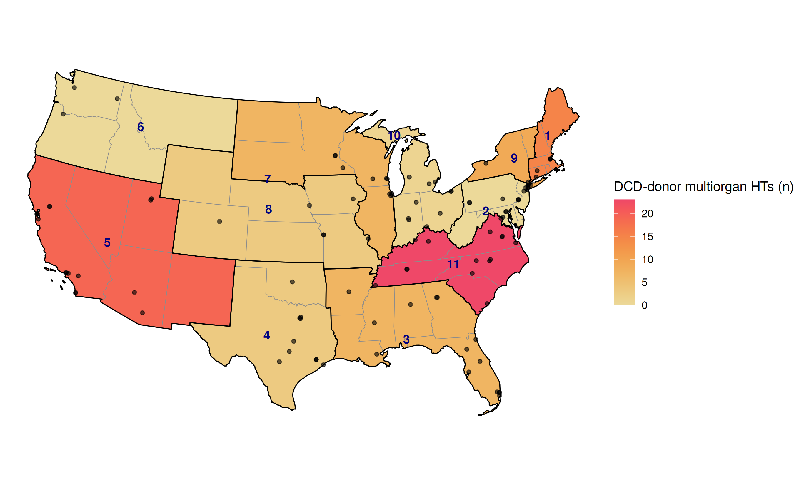{fig-alt="Map of the contiguous United States in an Albers projection, with states shaded by UNOS region from light yellow (low) to red (high) showing number of multiorgan heart transplants with DCD donors. Region 11 had the most (23), then Regions 5 (19) and 1 (15); Regions 2 and 6 had none. Thin outlines mark the eleven regions, each labelled with its number, and dots mark adult heart-transplant centers."}

:::

### Share of U.S. DCD-donor multiorgan heart transplants

::: {.panel-tabset}

#### With corridor inset (tmap)

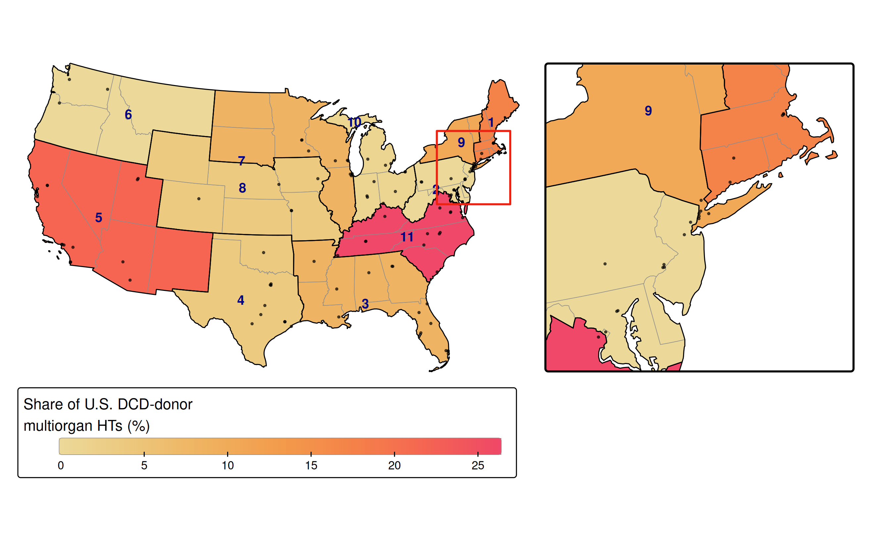{fig-alt="Map of the contiguous United States in an Albers projection, with states shaded by UNOS region from light yellow (low) to red (high) showing share of U.S. DCD-donor multiorgan heart transplants. Region 11 had the largest share (26%), then Regions 5 (22%) and 1 (17%); Regions 2 and 6 had none. Thin outlines mark the eleven regions, each labelled with its number, and dots mark adult heart-transplant centers. An enlarged view of the corridor from Washington, DC, to Boston sits to the right of the map."}

#### Without inset (ggplot2)

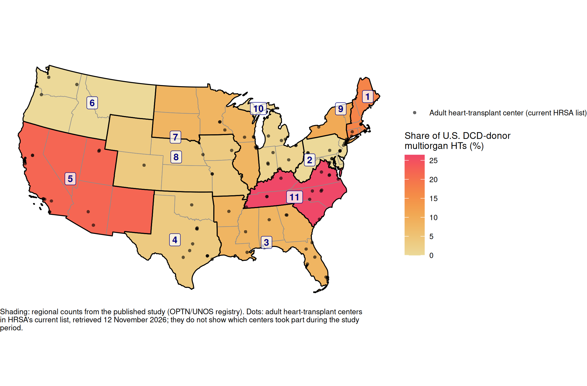{fig-alt="Map of the contiguous United States in an Albers projection, with states shaded by UNOS region from light yellow (low) to red (high) showing share of U.S. DCD-donor multiorgan heart transplants. Region 11 had the largest share (26%), then Regions 5 (22%) and 1 (17%); Regions 2 and 6 had none. Thin outlines mark the eleven regions, each labelled with its number, and dots mark adult heart-transplant centers."}

:::

### Number of all multiorgan heart transplants

::: {.panel-tabset}

#### With corridor inset (tmap)

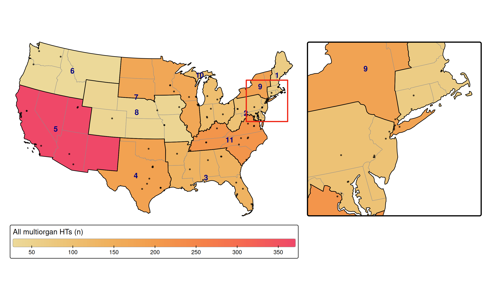{fig-alt="Map of the contiguous United States in an Albers projection, with states shaded by UNOS region from light yellow (low) to red (high) showing number of all multiorgan heart transplants. Region 5 had the most (374), then Regions 11 (211), 4 (182) and 9 (179); Region 6 had the fewest (27). Thin outlines mark the eleven regions, each labelled with its number, and dots mark adult heart-transplant centers. An enlarged view of the corridor from Washington, DC, to Boston sits to the right of the map."}

#### Without inset (ggplot2)

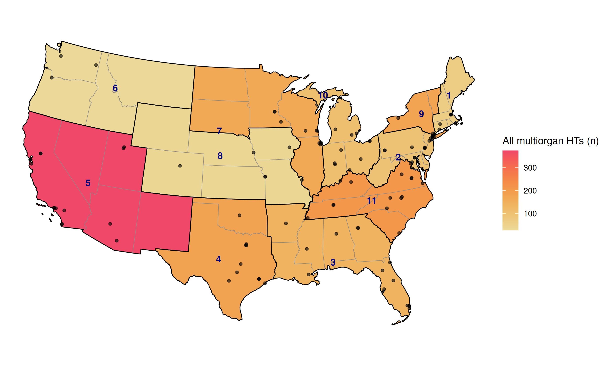{fig-alt="Map of the contiguous United States in an Albers projection, with states shaded by UNOS region from light yellow (low) to red (high) showing number of all multiorgan heart transplants. Region 5 had the most (374), then Regions 11 (211), 4 (182) and 9 (179); Region 6 had the fewest (27). Thin outlines mark the eleven regions, each labelled with its number, and dots mark adult heart-transplant centers."}

:::

### Share of all U.S. multiorgan heart transplants

::: {.panel-tabset}

#### With corridor inset (tmap)

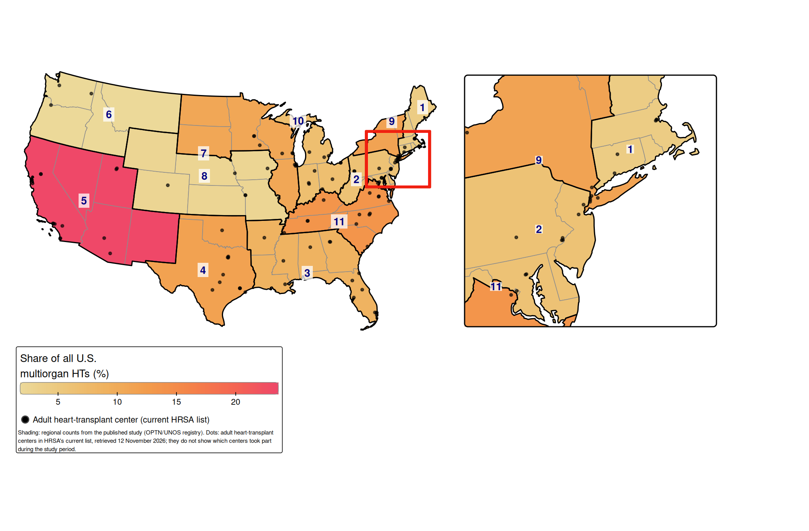{fig-alt="Map of the contiguous United States in an Albers projection, with states shaded by UNOS region from light yellow (low) to red (high) showing share of all U.S. multiorgan heart transplants. Region 5 had the largest share (24%), then Regions 11 (13%), 4 (12%) and 9 (11%); Region 6 had the smallest (2%). Thin outlines mark the eleven regions, each labelled with its number, and dots mark adult heart-transplant centers. An enlarged view of the corridor from Washington, DC, to Boston sits to the right of the map."}

#### Without inset (ggplot2)

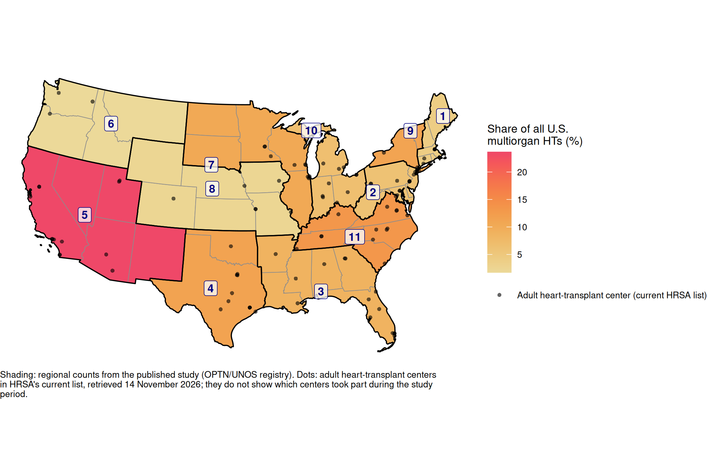{fig-alt="Map of the contiguous United States in an Albers projection, with states shaded by UNOS region from light yellow (low) to red (high) showing share of all U.S. multiorgan heart transplants. Region 5 had the largest share (24%), then Regions 11 (13%), 4 (12%) and 9 (11%); Region 6 had the smallest (2%). Thin outlines mark the eleven regions, each labelled with its number, and dots mark adult heart-transplant centers."}

:::

## Ex vivo machine perfusion, 2020–2024

From @madan2025evmp.

### Share of each region's DBD heart transplants using ex vivo machine perfusion

::: {.panel-tabset}

#### With corridor inset (tmap)

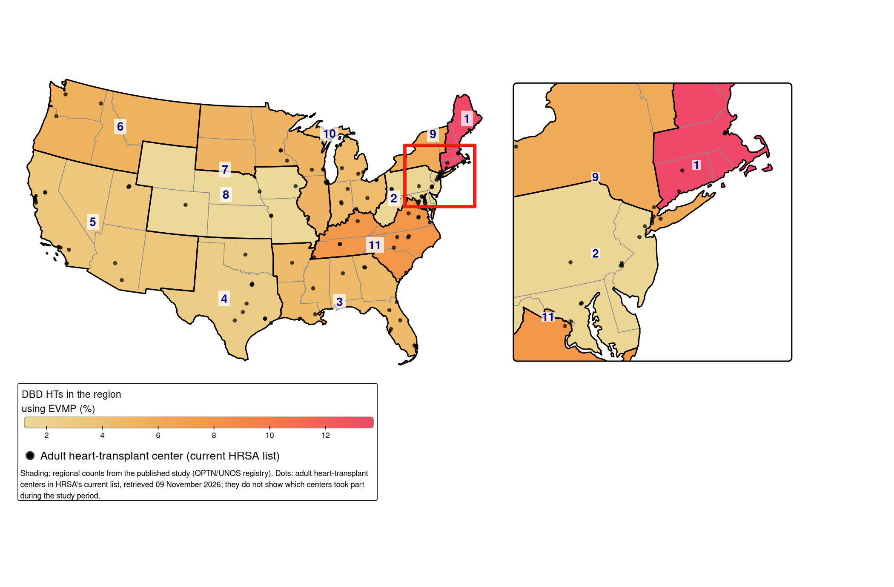{fig-alt="Map of the contiguous United States in an Albers projection, with states shaded by UNOS region from light yellow (low) to red (high) showing share of each region's DBD heart transplants using ex vivo machine perfusion. Region 1 had the highest rate (14%), then Regions 11 (8%), 9 (6%) and 6 (5%); Region 8 had the lowest (1%). Thin outlines mark the eleven regions, each labelled with its number, and dots mark adult heart-transplant centers. An enlarged view of the corridor from Washington, DC, to Boston sits to the right of the map."}

#### Without inset (ggplot2)

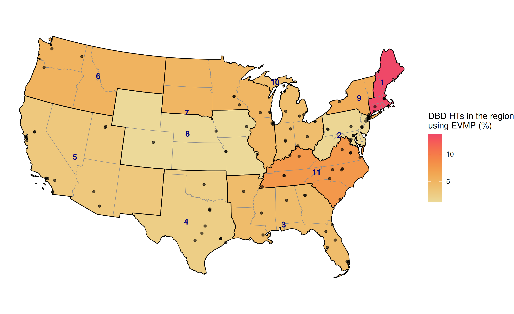{fig-alt="Map of the contiguous United States in an Albers projection, with states shaded by UNOS region from light yellow (low) to red (high) showing share of each region's DBD heart transplants using ex vivo machine perfusion. Region 1 had the highest rate (14%), then Regions 11 (8%), 9 (6%) and 6 (5%); Region 8 had the lowest (1%). Thin outlines mark the eleven regions, each labelled with its number, and dots mark adult heart-transplant centers."}

:::
