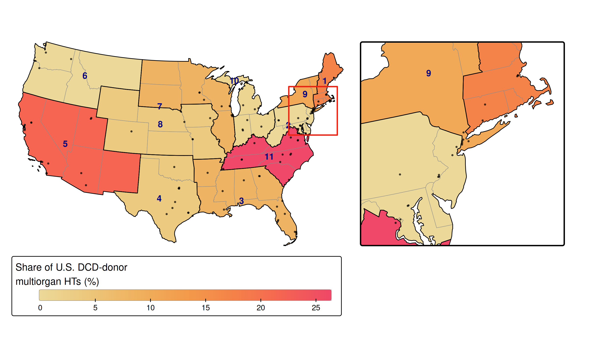
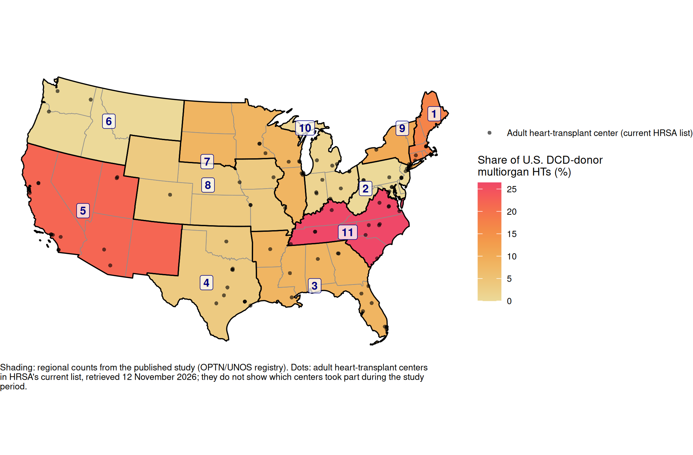
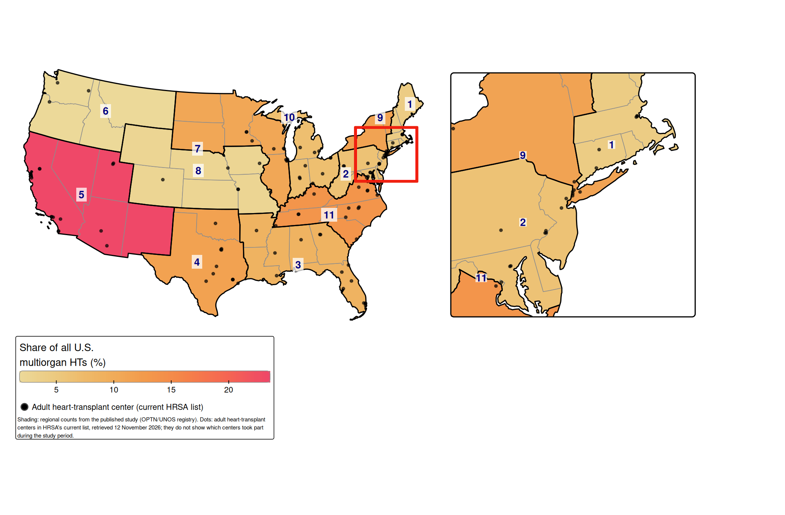
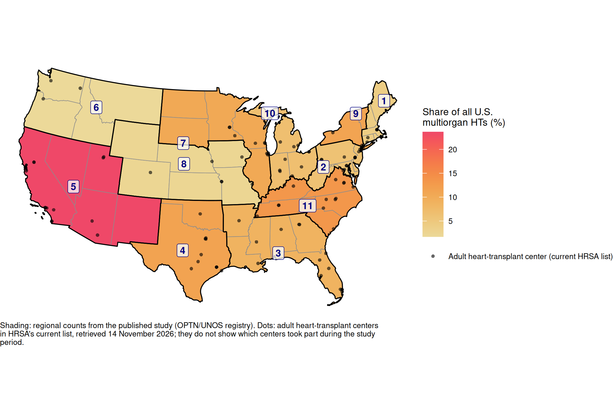



This page shows where in the United States multiorgan heart transplants from donors after circulatory death (DCD) were done, from @madan2024dcd, set beside where multiorgan heart transplants of every kind were done. How to read the maps in general is on [Reading the maps](results.qmd).

## The study in brief

Most donor hearts come from donors after brain death (DBD): the brain has stopped working but the heart is still beating when the organs are recovered. In donation after circulatory death, the heart has stopped before recovery. Hearts from DCD donors have become an important new source of organs, and their use has grown quickly.

The study used the UNOS registry to find the adult multiorgan heart transplants done in the United States from January 2020 to June 2023: 87 with DCD donors (77 heart-kidney, 6 heart-lung and 4 heart-liver) and 1,494 with DBD donors, 1,581 in all. DCD donors rose from 1% of multiorgan heart transplants in the first half of 2020 to 12% in the first half of 2023, with wide variation across UNOS regions and across centers of different size. Six-month survival after heart-kidney transplantation was similar with DCD and DBD donors [@madan2024dcd]. The maps show the regional part of that finding.

## What the maps show

There are two maps, both shares of a national count (see [Two kinds of percentage](results.qmd#two-kinds-of-percentage)):

1.  **Share of the country's DCD-donor multiorgan heart transplants**: each region's number of them divided by 87.
2.  **Share of all the country's multiorgan heart transplants**: each region's number of multiorgan heart transplants with any donor, DCD or DBD, divided by 1,581.

The first shows where DCD-donor transplants were done. The second shows where multiorgan heart transplants were done at all, which is what the first should be read against: a region that does many multiorgan heart transplants will tend to have a large share of the DCD ones too.

The original code also drew a map of each count. Because each share is the count divided by one national total, a count map has exactly the same colours as its share map; only the numbers in the legend differ. This page shows the share maps, the table gives the counts, and the count maps can be downloaded below.

## Map 1: DCD-donor transplants

::: {.panel-tabset}

#### With corridor inset (tmap)

{fig-alt="Map of the contiguous United States in an Albers projection, with states shaded by UNOS region from light yellow (low) to red (high) showing share of U.S. DCD-donor multiorgan heart transplants. Region 11 had the largest share (26%), then Regions 5 (22%) and 1 (17%); Regions 2 and 6 had none. Thin outlines mark the eleven regions, each labelled with its number, and dots mark current adult heart-transplant centers. An enlarged view of the corridor from Washington, DC, to Boston sits to the right of the map."}

#### Without inset (ggplot2)

{fig-alt="Map of the contiguous United States in an Albers projection, with states shaded by UNOS region from light yellow (low) to red (high) showing share of U.S. DCD-donor multiorgan heart transplants. Region 11 had the largest share (26%), then Regions 5 (22%) and 1 (17%); Regions 2 and 6 had none. Thin outlines mark the eleven regions, each labelled with its number, and dots mark current adult heart-transplant centers."}

:::

Download as PDF: share [with inset](../figures/dcd/pct_of_us_dcd_inset.pdf) or [without](../figures/dcd/pct_of_us_dcd.pdf); count [with inset](../figures/dcd/n_dcd_inset.pdf) or [without](../figures/dcd/n_dcd.pdf).

### Reading map 1

**Three regions did about two thirds of the DCD-donor transplants** (57 of 87, 66%): Region 11, from Virginia to Tennessee and the Carolinas, with 23 (26%); Region 5, from California to New Mexico, with 19 (22%); and Region 1, New England, with 15 (17%). Region 1 is small on the map, so look for it in the enlarged corridor of the tmap version.

**Two regions did none.** Region 2, from Pennsylvania to Washington, DC, and Region 6, the Northwest, did no DCD-donor multiorgan heart transplants in the study period. They are drawn in the lightest colour because their value is zero, not grey, because the value is known. Region 10 did one.

**The rest did between 3 and 9:** Region 9 (New York and Vermont) did 9, Regions 3 and 7 did 7 each, and Regions 4 and 8 did 3 each.

## Map 2: All multiorgan heart transplants

::: {.panel-tabset}

#### With corridor inset (tmap)

{fig-alt="Map of the contiguous United States in an Albers projection, with states shaded by UNOS region from light yellow (low) to red (high) showing share of all U.S. multiorgan heart transplants. Region 5 had the largest share (24%), then Regions 11 (13%), 4 (12%) and 9 (11%); Region 6 had the smallest (2%). Thin outlines mark the eleven regions, each labelled with its number, and dots mark current adult heart-transplant centers. An enlarged view of the corridor from Washington, DC, to Boston sits to the right of the map."}

#### Without inset (ggplot2)

{fig-alt="Map of the contiguous United States in an Albers projection, with states shaded by UNOS region from light yellow (low) to red (high) showing share of all U.S. multiorgan heart transplants. Region 5 had the largest share (24%), then Regions 11 (13%), 4 (12%) and 9 (11%); Region 6 had the smallest (2%). Thin outlines mark the eleven regions, each labelled with its number, and dots mark current adult heart-transplant centers."}

:::

Download as PDF: share [with inset](../figures/dcd/pct_of_us_total_inset.pdf) or [without](../figures/dcd/pct_of_us_total.pdf); count [with inset](../figures/dcd/n_total_inset.pdf) or [without](../figures/dcd/n_total.pdf).

### Reading map 2

**Region 5 stands out:** it did 374 of the 1,581 multiorgan heart transplants (24%), nearly twice as many as any other region. Regions 11 (211, 13%), 4 (182, 12%) and 9 (179, 11%) come next. The smallest are Region 6 (27, 2%) and Region 8 (38, 2%), and Region 1 (66, 4%).

This map is the background against which map 1 should be read. Its colour scale runs from 2% to 24%; map 1's runs from 0% to 26%. The colours of the two maps are therefore close but not identical in meaning, so compare them through the numbers.

## Comparing the two maps

Setting each region's share of DCD-donor transplants beside its share of all multiorgan heart transplants shows which regions did more DCD-donor transplants than their size would suggest:

-   **Far more than their size.** Region 1 had 17% of the DCD-donor transplants but only 4% of all multiorgan heart transplants, about four times as much: it is pale on map 2 and dark on map 1. Region 11 had about twice as much (26% against 13%).
-   **About in line with their size.** Region 5 (22% against 24%), Region 9 (10% against 11%) and Region 3 (8% against 9%). Region 5's dark colour on map 1 reflects mainly how many multiorgan heart transplants it does.
-   **Far less than their size.** Region 4, Texas and Oklahoma, had 12% of all multiorgan heart transplants but 3% of the DCD-donor ones, and Region 10 had 7% and 1%. Region 2 had 6% of all multiorgan heart transplants and none of the DCD-donor ones.
-   **Too few to say.** Region 8's 3 DCD-donor transplants (3%, against 2% of all) and Region 6's none (against 27 multiorgan heart transplants of any kind) rest on very small numbers.

This comparison is not the same as each region's own rate of DCD-donor use, which the published maps did not show.

**Decision pending:** whether to add a map of each region's own rate, its DCD-donor transplants divided by its own multiorgan heart transplants, labelled as not in the paper (D3 in `SETUP-NOTES.md`).

## The regional table

The counts and shares behind both maps. The table is saved by [`R/dcd_map.R`](dcd_map.qmd#regional-table) and read here, not recomputed.

```{r}
#| echo: false
#| eval: true
show_region_table("dcd")
```

## Points to keep in mind

-   **Small numbers.** There were 87 DCD-donor multiorgan heart transplants in three and a half years. Eight regions did 9 or fewer, so one or two transplants would change their colour a lot.
-   **A time of rapid change.** DCD use rose from 1% to 12% of multiorgan heart transplants over the study period, so the map adds together early years, when DCD donors were rarely used, and later years, when they were used far more. A region that started late may look light even if it uses DCD donors often now.
-   **Three kinds of transplant are combined.** Most of the 87 were heart-kidney transplants (77); the map also includes the 6 heart-lung and 4 heart-liver. The paper's survival analysis covered heart-kidney transplants only.
-   **Whole regions, not states.** The map says nothing about where within a region the transplants were done.
-   **The dots are today's centers.** The study ended in June 2023. The dots come from HRSA's list on the day the maps were drawn, and they do not show which centers did these transplants.

## The code

[3. DCD donors (2024)](dcd_map.qmd) shows the code that draws these maps, and [Original RMDs](original_code.qmd) the original code behind the published maps.
