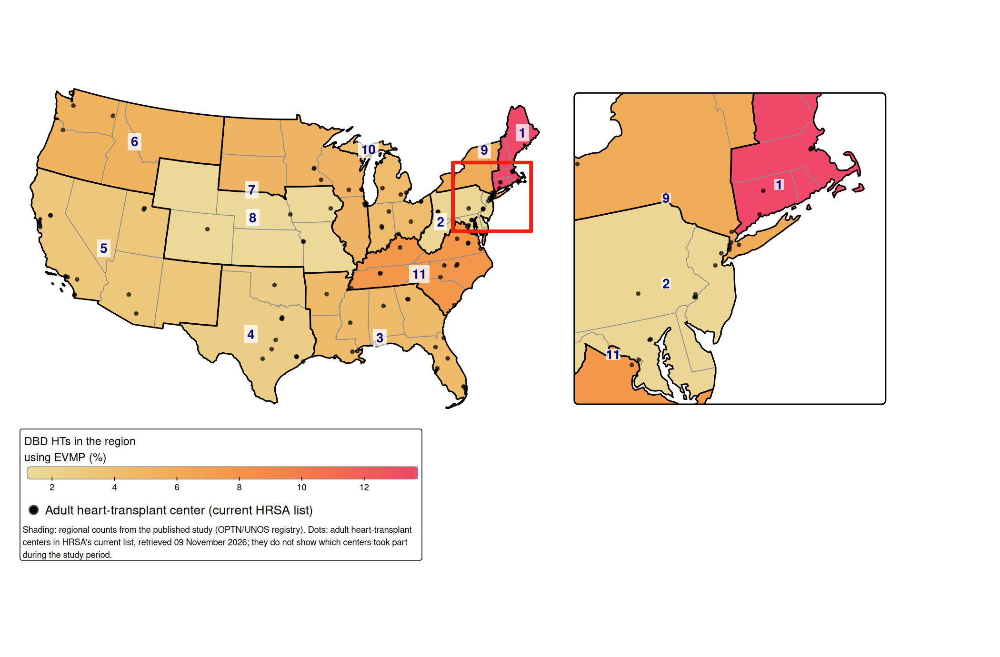
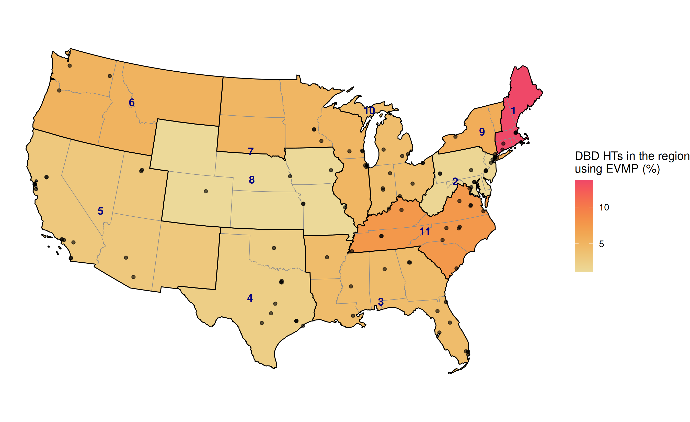



This page shows how often each UNOS region used ex vivo machine perfusion (EVMP) for heart transplants from donors after brain death (DBD), from @madan2025evmp. How to read the maps in general is on [Reading the maps](results.qmd).

## The study in brief

A donor heart is usually carried to the recipient's hospital on ice, in what is called *static cold storage*. The longer the heart is without blood flow (the *ischemic time*), the greater the risk of injury, and hearts from DBD donors are increasingly from older donors and travel longer distances. Ex vivo machine perfusion instead keeps fluid flowing through the heart from a machine outside the body ("ex vivo") during transport, which could reduce that risk.

The study used the UNOS registry to find the 12,363 adult DBD heart transplants done in the United States from January 2020 to June 2024 that met its criteria: 11,802 with static cold storage and 561 with EVMP. EVMP use rose from 1.4% in the first half of 2020 to 10.7% in the first half of 2024, with large differences between regions and with a few high-volume centers doing most of it. Survival at six months and one year was similar with EVMP and with cold storage, although the EVMP hearts came from older donors, travelled farther and had longer ischemic times [@madan2025evmp]. The map shows the regional part of that finding.

## What the map shows

Each region is shaded by **its own rate of EVMP use**: the region's DBD heart transplants that used EVMP divided by all the region's DBD heart transplants. Nationally, 561 of 12,363 (4.5%) did.

This is a different kind of percentage from the HCV and DCD maps (see [Two kinds of percentage](results.qmd#two-kinds-of-percentage)). The rates do not add up to 100%, and a region's colour does not depend on how many transplants it does. It answers the question *when this region did a DBD heart transplant, how often did it use machine perfusion?*

## The map

::: {.panel-tabset}

#### With corridor inset (tmap)

{fig-alt="Map of the contiguous United States in an Albers projection, with states shaded by UNOS region from light yellow (low) to red (high) showing share of each region's DBD heart transplants using ex vivo machine perfusion. Region 1 had the highest rate (14%), then Regions 11 (8%), 9 (6%) and 6 (5%); Region 8 had the lowest (1%). Thin outlines mark the eleven regions, each labelled with its number, and dots mark current adult heart-transplant centers. An enlarged view of the corridor from Washington, DC, to Boston sits to the right of the map."}

#### Without inset (ggplot2)

{fig-alt="Map of the contiguous United States in an Albers projection, with states shaded by UNOS region from light yellow (low) to red (high) showing share of each region's DBD heart transplants using ex vivo machine perfusion. Region 1 had the highest rate (14%), then Regions 11 (8%), 9 (6%) and 6 (5%); Region 8 had the lowest (1%). Thin outlines mark the eleven regions, each labelled with its number, and dots mark current adult heart-transplant centers."}

:::

Download as PDF: [with inset](../figures/evmp/pct_evmp_inset.pdf), [without inset](../figures/evmp/pct_evmp.pdf).

## Reading this map

**The darkest region is Region 1**, New England: 79 of its 577 DBD heart transplants used EVMP (14%), about three times the national rate. It is small on the main map; the enlarged corridor in the [{tmap}](https://r-tmap.github.io/tmap/) version shows it more clearly.

**Next comes Region 11**, from Virginia to Tennessee and the Carolinas, at 8% (129 of 1,687). Regions 9 (6%), 6 (5%) and 7 (5%) are also above the national 4.5%. Regions 3 and 10 are close to it (4% each).

**The lightest regions** are Region 8 in the central Plains (10 of 849, 1%) and Region 2, from Pennsylvania to Washington, DC (19 of 1,247, 2%). Region 4, Texas and Oklahoma, was at 2% and Region 5, from California to New Mexico, at 3%.

The map shows that use of EVMP was not simply a matter of size. Region 5 did more DBD heart transplants than any other region (1,993) but had one of the lower rates, while Region 1 did among the fewest (577) and had the highest.

## Rate and share tell different stories here

If the map showed each region's share of the country's 561 EVMP transplants instead, the picture would change. Region 11 did 129 of them (23%), the most of any region, and would be the darkest; Region 1, with 79 (14%), would come second. Region 5, with 61, would look middling (11%) rather than light.

The published map shows the rate, which answers how often each region chose machine perfusion rather than where most perfused hearts ended up. The table gives the counts, so either can be read from it.

## The regional table

The counts and rates behind the map. The table is saved by [`R/evmp_map.R`](evmp_map.qmd#regional-table) and read here, not recomputed.

```{r}
#| echo: false
#| eval: true
show_region_table("evmp")
```

## Points to keep in mind

-   **A few centers drove most of the use.** The paper found that a few high-volume centers did most EVMP transplants [@madan2025evmp]. A region's rate may therefore reflect one or two centers rather than practice across the region.
-   **A time of rapid change.** EVMP use rose from about 1% to about 11% over the study period. The map adds together all four and a half years, so it shows cumulative use, not current practice.
-   **DBD transplants only.** The study, and so the map, covered heart transplants from donors after brain death. Transplants from donors after circulatory death are not included.
-   **The rates rest on larger numbers than the other maps.** Every region did at least 399 DBD heart transplants, so the rates are steadier than the HCV and DCD shares. The smallest EVMP count was Region 8's 10.
-   **Whole regions, not states.** The map says nothing about where within a region EVMP was used.
-   **The dots are today's centers.** The study ended in June 2024. The dots come from HRSA's list on the day the map was drawn, and they do not show which centers used EVMP.

## The code

[4. Machine perfusion (2025)](evmp_map.qmd) shows the code that draws this map, and [Original RMDs](original_code.qmd) the original code behind the published map.
