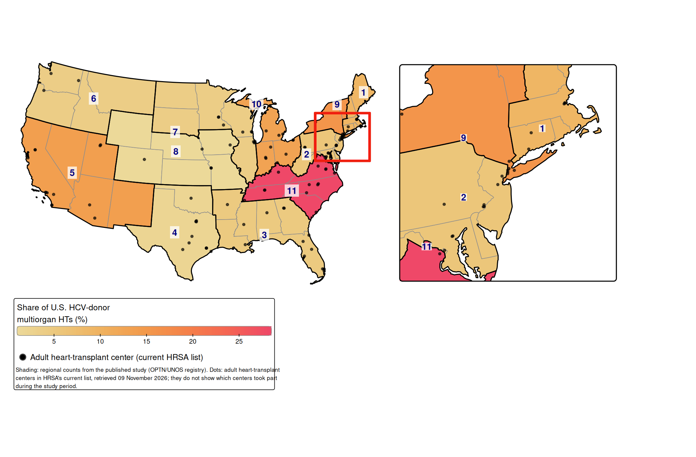
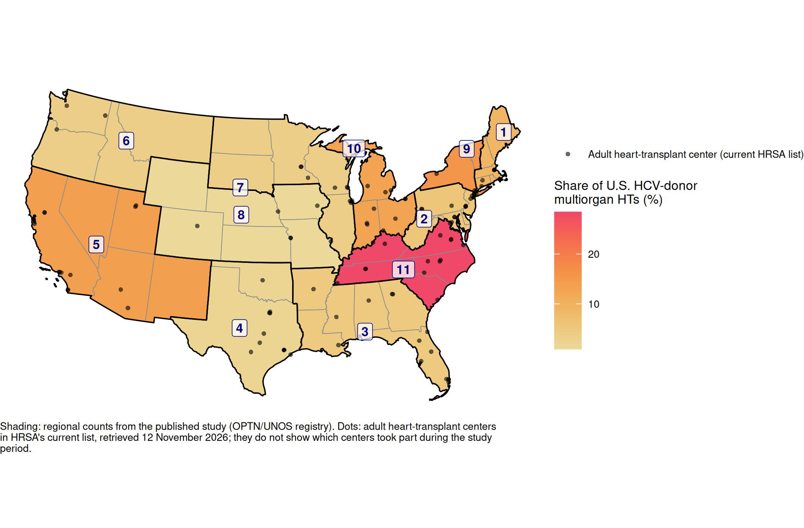



This page shows where in the United States multiorgan heart transplants from donors with hepatitis C virus (HCV) were done, from @madan2021hcv. How to read the maps in general is on [Reading the maps](results.qmd).

## The study in brief

Organs from donors with HCV were once rarely used, because the infection could pass to the recipient. Effective antiviral treatment made it possible to use them, adding to the small supply of organs for patients who need a heart and a second organ (see [Clinical background](background.qmd)).

The study used the UNOS registry to find all 1,322 adult multiorgan heart transplants done in the United States between August 2015 and August 2020: 986 heart-kidney, 155 heart-lung and 181 heart-liver. Of these, 109 used HCV donors. *HCV donor* here includes two groups: 77 donors with virus in the blood (positive on nucleic acid amplification testing, NAT, called *viremic*) and 32 with antibodies but no virus (antibody-positive, NAT-negative, *nonviremic*).

The share of multiorgan heart transplants using HCV donors rose from none in 2015 to 14% in 2020, with wide variation across UNOS regions and across centers of different size. One-year survival after heart-kidney transplantation was similar with HCV donors and with donors who had never had HCV [@madan2021hcv]. The map shows the regional part of that finding.

## What the map shows

Each region is shaded by its **share of the country's HCV-donor multiorgan heart transplants**: its number of them divided by 109, the national total. The eleven shares add up to 100%.

This is a share of the national count, not the region's own rate (see [Two kinds of percentage](results.qmd#two-kinds-of-percentage)). It shows where in the country the 109 transplants were done. It does not show how often each region chose an HCV donor when it did a multiorgan heart transplant.

## The map

::: {.panel-tabset}

#### With corridor inset (tmap)

{fig-alt="Map of the contiguous United States in an Albers projection, with states shaded by UNOS region from light yellow (low) to red (high) showing share of U.S. HCV-donor multiorgan heart transplants. Region 11 had the largest share (28%), followed by Regions 9 (16%), 5 (14%) and 10 (13%); Region 8 had the smallest (under 1%). Thin outlines mark the eleven regions, each labelled with its number, and dots mark current adult heart-transplant centers. An enlarged view of the corridor from Washington, DC, to Boston sits to the right of the map."}

#### Without inset (ggplot2)

{fig-alt="Map of the contiguous United States in an Albers projection, with states shaded by UNOS region from light yellow (low) to red (high) showing share of U.S. HCV-donor multiorgan heart transplants. Region 11 had the largest share (28%), followed by Regions 9 (16%), 5 (14%) and 10 (13%); Region 8 had the smallest (under 1%). Thin outlines mark the eleven regions, each labelled with its number, and dots mark current adult heart-transplant centers."}

:::

Download as PDF: [with inset](../figures/hcv/pct_of_us_hcv_inset.pdf), [without inset](../figures/hcv/pct_of_us_hcv.pdf).

## Reading this map

**The darkest region is Region 11**, the band from Virginia through Kentucky, Tennessee and the Carolinas. It did 31 of the 109 transplants (28%), more than a quarter of the country's total.

**Three more regions are mid-to-dark:** Region 9, mostly New York State, with 17 (16%); Region 5, from California to New Mexico, with 15 (14%); and Region 10, Indiana, Michigan and Ohio, with 14 (13%). Together with Region 11, these four regions did 77 of the 109 (71%).

**The lightest regions** are Region 8 in the central Plains, with 1 transplant (under 1%), and Region 4, Texas and Oklahoma, with 2 (2%). Regions 6 and 7 each did 4 (4%).

In the tmap version, the enlarged corridor shows that Regions 1, 2 and 9 meet in the crowded Northeast. Region 1, New England, did 10 (9%), and Region 2, from Pennsylvania to Washington, DC, did 6 (6%).

## Compared with all multiorgan heart transplants

A busy region tends to have a large share of any kind of transplant, so the map partly reflects how many multiorgan heart transplants each region did of any kind. The table below gives each region's share of all 1,322 as well. Setting the two shares side by side shows which regions did more HCV-donor transplants than their size alone would suggest:

-   **More than their size would suggest.** Region 11 had 28% of the HCV-donor transplants but 12% of all multiorgan heart transplants, more than twice as much. Region 9 (16% against 7%) and Region 1 (9% against 4%) were also more than twice their overall share, and Region 10 nearly twice (13% against 7%).
-   **Less than their size would suggest.** Region 5 did the most multiorgan heart transplants of any region (27% of all of them) but only 14% of those with HCV donors, about half. Region 4 had 11% of all multiorgan heart transplants and 2% of those with HCV donors, and Region 7 had 11% and 4%.
-   **Too few to say.** Region 6 had 4% of the HCV-donor transplants and 2% of all multiorgan heart transplants, which looks like a high ratio, but it rests on 4 HCV-donor transplants out of 20.

This comparison is not the same as each region's own rate of HCV-donor use, which the published map did not show.

**Decision pending:** whether to add a map of each region's own rate, its HCV-donor transplants divided by its own multiorgan heart transplants, labelled as not in the paper (D3 in `SETUP-NOTES.md`).

## The regional table

The counts behind the map, and the share of all multiorgan heart transplants used in the comparison above. The table is saved by [`R/hcv_map.R`](hcv_map.qmd#regional-table) and read here, not recomputed.

```{r}
#| echo: false
#| eval: true
show_region_table("hcv")
```

## Points to keep in mind

-   **Small numbers.** Seven of the eleven regions did 10 or fewer HCV-donor multiorgan heart transplants in five years, and Region 8 did one. In those regions, one or two transplants more or fewer would change the colour a lot.
-   **Two kinds of donor and three kinds of transplant are combined.** The 109 include viremic and nonviremic donors, and heart-kidney, heart-lung and heart-liver transplants. The paper's survival analysis covered heart-kidney transplants only; the map covers all three.
-   **Whole regions, not states.** The shading of New York and Vermont is the same because both are in Region 9; the map says nothing about where within the region the transplants were done.
-   **The dots are today's centers.** The study ended in August 2020. The dots come from HRSA's list on the day the maps were drawn, so they may include centers that did not exist then and miss some that have closed. They do not show which centers did these transplants.

## The code

[2. HCV donors (2021)](hcv_map.qmd) shows the code that draws this map, and [Original RMDs](original_code.qmd) the original code behind the published map.
